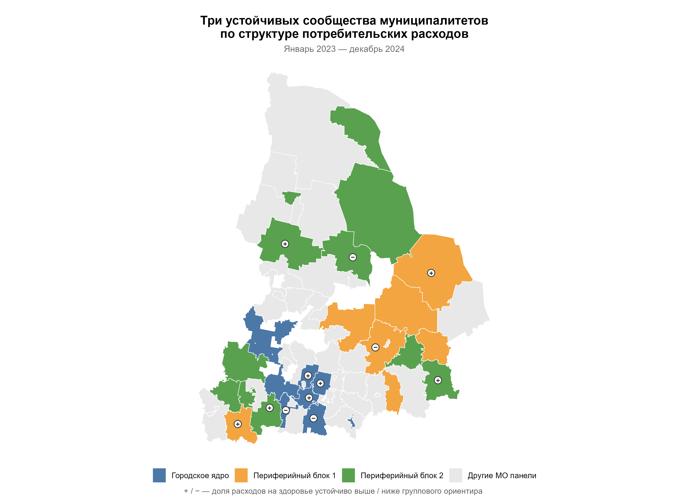
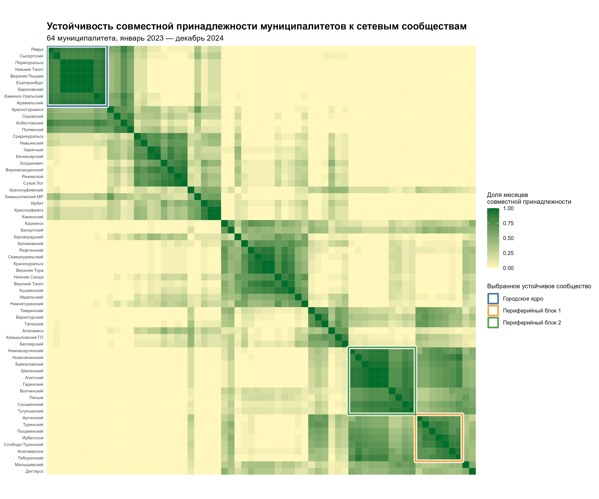
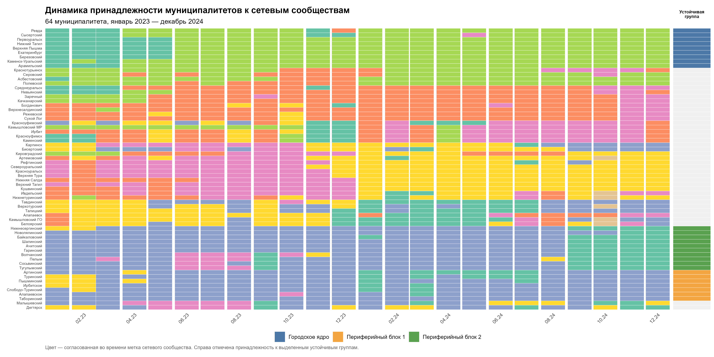

# Сетевой анализ структуры потребительских расходов муниципальных образований Свердловской области

**Конкурс СберИндекс — 2026  
Направление: Кластеризация**

## 1. О проекте

Проект посвящён выявлению и анализу устойчивых сообществ муниципальных образований Свердловской области на основе сходства структуры потребительских расходов населения.

В отличие от подходов, ориентированных исключительно на уровень расходов или географическую близость территорий, в работе рассматривается сходство потребительских профилей муниципалитетов. Муниципальные образования представляются вершинами сети, а связи между ними формируются на основе близости структуры расходов.

Особое внимание уделяется изменению сетевых сообществ во времени, устойчивости совместной принадлежности муниципалитетов к сообществам и экономической интерпретации выявленных закономерностей.

**Цель проекта** — разработать воспроизводимый подход к выявлению устойчивых групп муниципальных образований со сходной структурой потребительских расходов и исследовать их пространственные и социально-экономические особенности.

Исследование выполнено на материалах Свердловской области за январь 2023 — декабрь 2024 года.

## 2. Исходные данные

В исследовании используются данные о потребительских расходах населения, социально-экономических характеристиках муниципальных образований и их географических границах.

Основные источники:

1. СберИндекс. «Потребительские безналичные расходы на уровне муниципальных образований». Описание набора данных. [Источник](https://sberindex.ru/ru/research/data-sense-opisanie-nabora-dannikh-khakatona-sberindeksa-po-munitsipalnim-dannim)

2. СберИндекс. «Данные о границах и преобразованиях муниципальных образований». Описание набора данных. [Источник](https://sberindex.ru/ru/research/dataset-borders-and-changes-of-municipalities)

3. Управление Федеральной службы государственной статистики по Свердловской области и Курганской области (Свердловскстат). Данные о численности населения, заработной плате и отраслевой структуре занятости муниципальных образований. Основные показатели. [Источник](https://66.rosstat.gov.ru/main_indicators)

**Территориальный охват:** Свердловская область.

**Период исследования:** январь 2023 — декабрь 2024 года.

После проверки полноты наблюдений сформирована сбалансированная панель из 64 муниципальных образований за 24 месяца (1536 наблюдений).

Для построения сетей используются доли расходов по четырём категориям: продовольствие, маркетплейсы, общественное питание и транспорт. Категория «Здоровье» исключена из признаков кластеризации и используется для последующей диагностики устойчивых отклонений.

### Цитирование и лицензия данных СберИндекса

*Потребительские безналичные расходы на уровне муниципальных образований*. СберИндекс. Данные доступны по адресу [https://sberindex.ru/ru/research/data-sense-opisanie-nabora-dannikh-khakatona-sberindeksa-po-munitsipalnim-dannim](https://sberindex.ru/ru/research/data-sense-opisanie-nabora-dannikh-khakatona-sberindeksa-po-munitsipalnim-dannim) (данные скачаны 14.09.2026).

*Consumer spending at the municipal level*. Sberindex. Available at [https://sberindex.ru/ru/research/data-sense-opisanie-nabora-dannikh-khakatona-sberindeksa-po-munitsipalnim-dannim](https://sberindex.ru/ru/research/data-sense-opisanie-nabora-dannikh-khakatona-sberindeksa-po-munitsipalnim-dannim) (data downloaded on 2026-09-14).

**Лицензия набора данных:** [Creative Commons Attribution 4.0 International (CC BY 4.0)](https://creativecommons.org/licenses/by/4.0/), согласно информации СберИндекса. Это указание относится к исходному набору данных и не определяет лицензию авторского программного кода проекта. Исходные данные в репозитории не размещаются.

**Доступность данных**: Исходные файлы не включены в публичный репозиторий. Их перечень, назначение, источники получения и требования к размещению приведены в документе [«Описание исходных данных»](docs/data_description.md). Для воспроизведения расчётов необходимо получить соответствующие данные и разместить их в каталоге raw/.

## 3. Методология

### 3.1. Формирование потребительских профилей

Для каждого муниципального образования и месяца рассчитывается структура расходов по выбранным категориям.

Поскольку доли расходов образуют композиционные данные, применяется CLR-преобразование (Centered Log-Ratio), позволяющее анализировать относительные соотношения компонентов потребительского профиля.

### 3.2. Построение муниципальных сетей

Для каждого месяца формируется отдельная взвешенная сеть муниципальных образований.

- Вершины сети — муниципальные образования.

- Связи отражают близость потребительских профилей.

- Расстояния рассчитываются в пространстве CLR-преобразованных признаков.

- Сетевые связи формируются по принципу объединённого графа k ближайших соседей (union-kNN).

- Веса связей определяются преобразованием расстояний с экспоненциальным убыванием.

В основной спецификации используется $k = 5$.

Всего строятся 24 месячные сети.

### 3.3. Выявление сетевых сообществ

Для определения групп муниципалитетов со сходной структурой расходов используется алгоритм Лувена, основанный на оптимизации модулярности сети.

Кластеризация выполняется отдельно для каждого месяца, что позволяет исследовать изменения состава сообществ во времени.

### 3.4. Проверка качества и устойчивости

Для оценки выбранного подхода выполняются:

- анализ чувствительности к числу ближайших соседей при $k = 3, 5$ и $7$;

- сравнение сетевой кластеризации Лувена с методом k-means;

- расчёт внутренних показателей качества кластеризации, включая силуэтный коэффициент ($SW$), индекс Калински–Харабаша ($CH$), индекс $S_{Dbw}$, показатели $AVI$, $AVU$ и Modularity Quality ($MQ$);

- согласование меток сетевых сообществ между месяцами;

- расчёт попарной устойчивости совместной принадлежности муниципалитетов к сообществам.

Попарная устойчивость определяется как доля месяцев, в течение которых два муниципальных образования принадлежали одному сетевому сообществу.

### 3.5. Экономическая интерпретация

Для содержательной интерпретации результатов используются внешние социально-экономические показатели, включая заработную плату, численность населения и отраслевую структуру занятости.

Отдельно анализируется категория расходов «Здоровье», исключённая из признаков первоначальной кластеризации.

Для каждого муниципалитета рассчитывается отклонение доли расходов на здоровье от сетевого ориентира, определяемого по близким муниципалитетам. Рассматриваются величина, направленность и временная устойчивость отклонений.

Результаты этого анализа интерпретируются как описательные различия потребительских профилей, а не как прямое доказательство различий в доступности медицинской помощи.

## 4. Структура проекта

```text
sberindex-municipal-networks/
├── R/
│   ├── 01_prepare_consumption.R
│   ├── 02_build_networks.R
│   ├── 03_cluster_validation.R
│   ├── 04_temporal_stability.R
│   ├── 05_external_interpretation.R
│   ├── 06_health_outliers.R
│   └── 07_visualization.R
├── docs/
│   └── data_description.md
├── raw/
├── processed/
├── figures/
├── config.yml
├── run_all.R
├── .gitignore
└── sberindex-municipal-networks.Rproj
```

### Назначение программных модулей

| Модуль | Назначение |
| --- | --- |
| `01_prepare_consumption.R` | Подготовка исходной панели расходов и CLR-преобразование |
| `02_build_networks.R` | Построение месячных сетей и выявление сообществ |
| `03_cluster_validation.R` | Сравнение методов, расчёт метрик качества и анализ чувствительности |
| `04_temporal_stability.R` | Согласование сообществ во времени и анализ попарной устойчивости |
| `05_external_interpretation.R` | Сопоставление результатов с внешними социально-экономическими показателями |
| `06_health_outliers.R` | Диагностика устойчивых отклонений расходов на здоровье |
| `07_visualization.R` | Построение итоговых карт и графиков |

## 5. Запуск проекта

### Программное обеспечение и зависимости

Проект разработан и протестирован в следующем программном окружении:

- R: 4.2.2 (2022-10-31 ucrt)

- RStudio: 2025.09.0+387

- Операционная система: Windows

Для выполнения расчётов используются следующие пакеты R:

| Назначение | Пакеты |
| --- | --- |
| Обработка данных | `tidyverse`, `janitor`, `lubridate` |
| Чтение данных | `arrow`, `readxl` |
| Сетевой анализ | `igraph` |
| Кластеризация и оценка качества | `cluster`, `clusterCrit`, `mclust` |
| Дополнительные вычисления | `gtools` |
| Пространственный анализ | `sf` |
| Визуализация | `ggplot2`, `patchwork`, `ggalluvial` |
| Чтение конфигурации | `yaml` |

### Версии пакетов

| Пакет | Версия | Пакет | Версия |
| --- | --- | --- | --- |
| `tidyverse` | 2.0.0 | `janitor` | 2.2.1 |
| `lubridate` | 1.9.2 | `arrow` | 15.0.1 |
| `readxl` | 1.4.3 | `igraph` | 2.0.1.1 |
| `cluster` | 2.1.4 | `clusterCrit` | 1.3.0 |
| `mclust` | 6.1.3 | `gtools` | 3.9.5 |
| `sf` | 1.0.16 | `patchwork` | 1.3.0 |
| `ggalluvial` | 0.12.6 | `yaml` | 2.3.12 |

Пакеты `dplyr`, `tidyr`, `purrr`, `stringr` и `readr` также используются непосредственно и входят в состав `tidyverse`.

### Конфигурация расчётов

Основные параметры исследования вынесены в файл `config.yml`, расположенный в корневом каталоге проекта. Это позволяет воспроизводить расчёты с исходными настройками и изменять параметры без редактирования основных алгоритмов.

| Параметр | Значение | Назначение |
| --- | --- | --- |
| `network.k` | 5 | Число ближайших соседей при построении ежемесячных сетей union-kNN |
| `network.sensitivity_k` | [3, 5, 7] | Значения числа соседей для анализа чувствительности результатов кластеризации |
| `health.min_gap_pp` | 0.4 | Минимальное абсолютное среднее отклонение доли расходов на здоровье от группового ориентира, в процентных пунктах |
| `health.min_months` | 20 | Минимальное число месяцев с устойчивым направлением отклонения из 24 месяцев наблюдения |

Представленные в исследовании результаты получены с указанными исходными настройками. Контрольные проверки отдельных модулей также ориентированы на воспроизведение этих результатов; при изменении параметров может потребоваться корректировка соответствующих проверок.

### Порядок запуска

1. Открыть файл `sberindex-municipal-networks.Rproj`.

2. Установить необходимые пакеты R, используемые в аналитических модулях.

3. Разместить исходные файлы в каталоге `raw/` с именами и структурой, ожидаемыми программой.

4. Выполнить основной скрипт:

```r
source("run_all.R")
```

Скрипт последовательно запускает семь аналитических модулей — от подготовки исходных данных до построения итоговых визуализаций.

Ограничение воспроизводимости: исходные данные не распространяются вместе с репозиторием. Поэтому полное повторение численных результатов требует доступа к соответствующим исходным наборам.

## 6. Основные результаты

По результатам анализа сформированы 24 месячные сети потребительского сходства и рассчитаны показатели устойчивости совместной принадлежности муниципалитетов к сетевым сообществам.

Выделены три устойчивых объединения, представляющих особый интерес для экономической интерпретации:

- Городское ядро — 9 муниципальных образований.

- Периферийный блок 1 — 7 муниципальных образований.

- Периферийный блок 2 — 10 муниципальных образований.

Остальные 38 муниципальных образований продолжают участвовать в анализе месячных сетей и устойчивости, но не включены в три выделенных сообщества. Это не означает отсутствия устойчивых связей между ними.

Дополнительно выявлены 12 устойчивых отклонений расходов на здоровье от сетевого ориентира: 8 положительных и 4 отрицательных.

Результаты представлены в трёх итоговых визуализациях.

### 6.1. Пространственное распределение устойчивых сообществ



Карта показывает пространственное размещение трёх выделенных сообществ и муниципалитеты с устойчивыми положительными и отрицательными отклонениями расходов на здоровье.

### 6.2. Матрица попарной устойчивости



Матрица отражает частоту совместной принадлежности муниципальных образований к одним и тем же сетевым сообществам за 24 месяца наблюдений.

### 6.3. Динамика сетевых сообществ



Диаграмма позволяет проследить изменение принадлежности каждого муниципального образования к согласованным сетевым сообществам во времени.

## 7. Ограничения исследования

При интерпретации результатов необходимо учитывать следующие обстоятельства:

- потребительские расходы отражают наблюдаемое поведение в используемом источнике данных и не обязательно полностью характеризуют расходы всех жителей;

- сходство структуры расходов не означает географической близости или наличия прямых экономических связей между муниципалитетами;

- выявленные сообщества представляют результат выбранной сетевой модели и зависят от её параметров;

- результаты внешней интерпретации не устанавливают причинно-следственные связи;

- отклонения расходов на здоровье не могут непосредственно отождествляться с доступностью или качеством медицинской помощи.

## 8. Назначение репозитория

Репозиторий подготовлен для представления проекта на конкурсе СберИндекс — 2026 по направлению «Кластеризация».

Содержит программную реализацию подхода, материалы для проверки методологии и визуализации результатов исследования.
